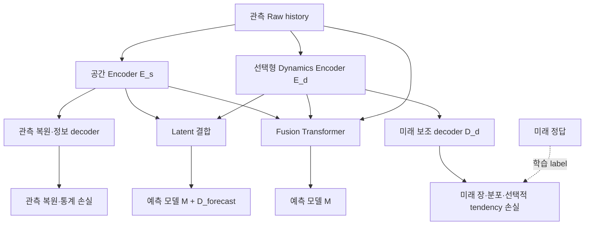

# 선택형 Dynamics Encoder를 추가한 Climate Manifold

브랜치: `feature/dual-dynamics-manifold`

기존 통계 Encoder와 Fusion Transformer를 유지하고 **별도 Dynamics Encoder `E_d`**를
선택적으로 추가합니다. `E_d`는 관측 history의 시간 변화를 표현하며, 동일한 `E_d`를
예측 경로와 미래 보조 감독 경로가 함께 학습합니다. Latent 방식과 Guided 방식은
서로 다른 실험군으로 유지합니다. 기존 설정에서는 dynamics가 꺼져 있습니다.

## 모듈과 두 경로

| 모듈 | 입력 → 출력 | 역할 |
|---|---|---|
| 기존 공간 Encoder `E_s` | 관측 기상장·origin 정보 → 공간 latent | 관측 복원·통계 정보 보존 |
| 선택형 Dynamics Encoder `E_d` | 관측 기상장 history → 시간 변화 표현 | 관측 시퀀스에서 미래에 유용한 표현 추출 |
| Dynamics 보조 decoder `D_d` | `E_d` 출력·lead → 미래 기상장 | 미래 정답을 label로 사용해 `E_d` 감독 |
| Fusion Transformer `T` | Raw history + 공간 guide + dynamics guide → 기상장 크기의 표현 | Guided 경로의 manifold 구성 |
| 예측 모델 `M` | latent 또는 Fusion 표현 → 미래 예측 | 기존 예측 모델을 교체해 비교 |

`E_d`는 `conv_gru` 또는 `temporal_conv` 중 선택합니다. 첫 번째는 공간 ConvGRU를 통한
시퀀스 처리, 두 번째는 temporal convolution을 통한 관측 시간축 처리를 사용합니다.
두 구현 모두 **결정론적**이며, SDE·확률적 latent sampling·앙상블 보정을 구현하는
것은 아닙니다. 전체 설정을 끄는 CLI 값은 `--dynamics-encoder off`입니다.



아래의 Latent와 Guided는 **각각 독립적으로 학습하는 비교 경로**입니다.

\[
z_s=E_s(X,I),\qquad z_d=E_d(X),
\]

\[
\text{Latent:}\quad \widehat Y=D_{\mathrm{forecast}}\bigl(M(z_s+P(z_d))\bigr),
\]

\[
\text{Guided:}\quad H=T(X,z_s,z_d),\qquad \widehat Y=M(H,I).
\]

`P`는 dynamics 표현을 spatial latent와 결합하도록 크기·채널을 맞추는 학습 모듈입니다.
Latent 경로의 `M`에는 보조 정보 `I`를 직접 전달하지 않으며, `I`는 `E_s`를 통해 반영됩니다.
Guided 경로에서 `T`까지가 manifold이며, 뒤의 `M`은 별도 예측 모델입니다. `M=transformer`를
선택해도 앞단 Fusion과 뒤의 예측 Transformer는 서로 다른 모듈입니다.

보조 경로는 `D_d(z_d, lead)`가 미래 기상장을 예측해 학습 신호를 제공하는 구조입니다.
실제 예측 결과는 계속 `M`을 거쳐 생성됩니다. `D_d` 출력을 실제 미래 관측처럼 예측기에
넣거나, 미래 정답을 `E_s`, `E_d`, `T`, `M`의 입력에 넣지 않습니다. 추론 시 보조 decoder는
필요하지 않습니다. 관측 history의 길이가 1이면 시간 변화의 근거가 부족하므로 dynamics
실험은 두 시점 이상으로 구성합니다.

## 공동 학습과 손실

\[
\mathcal L=\mathcal L_{\mathrm{forecast}}
 +\mathcal L_{\mathrm{observed}}
 +\lambda_{d,r}\mathcal L_{d,\mathrm{field}}
 +\lambda_{d,s}\mathcal L_{d,\mathrm{stat}}
 +\lambda_{d,t}\mathcal L_{d,\mathrm{tendency}}.
\]

- 예측 손실은 `E_s`, `E_d`, `M`과 해당 경로의 `T` 또는 `D_forecast`를 함께 학습합니다.
- 관측 복원·통계 손실은 기존 `E_s → D_rec / D_info` 경로를 유지합니다.
- Dynamics 보조 손실은 `E_d → D_d`를 직접 학습합니다. 미래 장 정답과 비교하는 supervised
  objective이며, 미래 정답을 입력하는 teacher forcing은 하지 않습니다.
- Dynamics의 통계 손실은 공간 통계 손실과 별도로 W2·KL-entropy·signed measure를 선택할 수
  있습니다. 별도 지정이 없으면 공간 통계 손실을 따릅니다.
- 기본 dynamics 장 손실·통계 손실 가중치는 각각 `0.1`, tendency 가중치는 `0.0`입니다.
  `off`이면 dynamics 관련 모듈·손실은 비활성화됩니다.
- Dynamics 보조 target은 현재 archive에 포함된 **선택 surface 기상 변수**입니다. 보조
  sidecar의 미래 Z850/Z500 등의 별도 정보장을 복원하는 head는 추가하지 않습니다.
- Latent의 `P`와 Fusion의 최종 보정 head는 0으로 초기화됩니다. 첫 update에서 예측
  손실의 `E_d` gradient가 0일 수 있으며, 보정 계층이 학습되면서 전달됩니다. 활성화된
  미래 보조 손실은 첫 update부터 별도 경로로 `E_d`를 학습시킵니다.
- 기존 PINN·static penalty·statistical flow·conditional flow는 이 runner에서 계속 꺼집니다.
  지형 등의 origin 입력 정보는 기존과 같이 유지합니다.

W2의 주변분포 일치는 고·저기압의 **위치나 시간 궤적**의 일치를 보장하지 않습니다.
KL-entropy도 분포 비교이며 VAE prior KL이 아닙니다. Signed measure는 정규화된
기압·온도 등 각 필드의 양/음 공간 질량을 비교하며, 기준 0은 0 Pa가 아닙니다.
미래 분포 보조 손실만으로 완전한 dynamics를 얻었다고 주장할 수 없습니다. 실제 예측장의
lead별 오차·시간 변화·장기 안정성을 별도로 평가해야 합니다.

## 비교군과 해석

| arm | Dynamics 예측 입력 | 확인 목적 |
|---|---|---|
| `raw` | 없음 | Raw → M 기준선 |
| `latent` | 없음 | 기존 E_s → M → D 기준선 |
| `guided` | 없음 | 기존 T(Raw, E_s) → M 기준선 |
| `guided_zero` | 없음; 공간 guide도 0 | 기존 공간 guide 내용의 기여 |
| `latent_dynamics` | 학습된 `E_d` 표현 | 압축 latent에서 dynamics 추가 효과 |
| `guided_dynamics` | 학습된 `E_d` guide | Raw+guide manifold에서 dynamics 추가 효과 |
| `latent_dynamics_zero` | 결합 지점의 dynamics 입력을 0 | 동일 temporal 구조에서 dynamics 내용 기여 |
| `guided_dynamics_zero` | 결합 지점의 dynamics guide를 0 | 동일 Fusion 구조에서 dynamics 내용 기여 |

Zero dynamics 대조군에서도 `E_d`와 보조 decoder는 존재하고 보조 손실로 학습합니다.
예측 경로만 dynamics 내용이 차단됩니다. 같은 `M`·seed·평가 origin·lead를 짝지어 비교하세요.
Dynamics on/off 차이에는 추가 용량과 보조 감독이 함께 포함되므로, learned/zero 대조와
함께 해석해야 합니다. Zero spatial guide와 zero dynamics guide는 다른 대조입니다.

기존 `run_guided_fusion_comparison.sh` 기본은 여전히 **8개 M × 4개 arm × 3개 seed = 96회**입니다.
`INCLUDE_DYNAMICS=1`이면 dynamics 비교군 4개가 추가되어 **192회**가 됩니다.
`INCLUDE_ZERO_DYNAMICS=0`이면 추가 대조군 2개를 제외하여 **144회**입니다.
`INCLUDE_GUIDED_FORECAST_ONLY=1`은 기존 관측 제약 제거 대조군 1개를 더합니다.

## 새 브랜치부터 전체 학습·test·그래프까지

할당받은 GPU 세션에서 실행합니다. 코드·가상환경·cache·전처리·모든 결과는
`/lustre/home/yehyeon` 아래에 만들고, 원본 ERA5는
`/lustre/home/mahmed/ERA5_0p25_DAILY`에서 읽기만 합니다. 기본은 **16×32 격자,
연속 6일 관측 → 미래 1~5일, batch 16**입니다.

```bash
bash <<'BASH'
set -euo pipefail
cd /lustre/home/yehyeon
export DAILY_WORK
DAILY_WORK=$(mktemp -d "$PWD/climate_manifold_dynamics_XXXXXXXX")
export ERA5_ROOT=/lustre/home/mahmed/ERA5_0p25_DAILY
mkdir -p "$DAILY_WORK"/{tmp,cache,logs}
export TMPDIR="$DAILY_WORK/tmp" TMP="$DAILY_WORK/tmp" TEMP="$DAILY_WORK/tmp"
export XDG_CACHE_HOME="$DAILY_WORK/cache" PIP_CACHE_DIR="$DAILY_WORK/cache/pip"
export TORCH_HOME="$DAILY_WORK/cache/torch" HF_HOME="$DAILY_WORK/cache/huggingface"
export CUDA_CACHE_PATH="$DAILY_WORK/cache/cuda" TRITON_CACHE_DIR="$DAILY_WORK/cache/triton"
export PYTHONPYCACHEPREFIX="$DAILY_WORK/cache/pycache" MPLCONFIGDIR="$DAILY_WORK/cache/matplotlib"
export NUMBA_CACHE_DIR="$DAILY_WORK/cache/numba" PYTHONNOUSERSITE=1

git clone --single-branch --branch feature/dual-dynamics-manifold \
  https://github.com/nayehyeon61-glitch/climate_manifold.git "$DAILY_WORK/code"
cd "$DAILY_WORK/code"
python3 -m venv "$DAILY_WORK/venv"
source "$DAILY_WORK/venv/bin/activate"
python -m pip install --upgrade pip
python -m pip install 'torch==2.8.0' --index-url https://download.pytorch.org/whl/cu128
python -m pip install 'xarray==2024.11.0' -e '.[forecast,era5,test,plots]'

export PYTHON="$DAILY_WORK/venv/bin/python" DEVICE=cuda
export MODELS="mlp neural_ode climode convlstm simvp fourcastnet climax transformer"
export SEEDS="7 19 43" EPOCHS=20 BATCH_SIZE=16
export INCLUDE_DYNAMICS=1 INCLUDE_ZERO_DYNAMICS=1 DYNAMICS_ENCODER=conv_gru
export DYNAMICS_HIDDEN_DIM=32 DYNAMICS_CHANNELS=8
export STATISTICAL_LOSS=signed_measure DYNAMICS_STATISTICAL_LOSS=signed_measure
export DYNAMICS_RECONSTRUCTION_WEIGHT=0.1 DYNAMICS_STATISTICAL_WEIGHT=0.1 DYNAMICS_TENDENCY_WEIGHT=0
export INCLUDE_ZERO_GUIDE=1 INCLUDE_GUIDED_FORECAST_ONLY=0
export CONSTRAINT_DECODER=separate_surface_and_information
export VARIABLE_CONDITIONING=0 GUIDE_DIRECT_INFORMATION=1
export STATISTICAL_FLOW_WEIGHT=0 CONDITIONAL_FLOW_WEIGHT=0
export START_DATE=1979-01-01 END_DATE=2025-12-31
export TARGET_LAT_POINTS=16 TARGET_LON_POINTS=32
export HISTORY_STEPS=6 HORIZON_STEPS=5 MAX_WINDOWS=0 MAX_CASES=0 ORIGIN_STRIDE=1
export RUN_PREFLIGHT_TESTS=1 EVALUATE_TEST=1 MAKE_PLOTS=1 OMP_NUM_THREADS=4
export GPU_MAX_UTILIZATION=10 GPU_MAX_MEMORY_PERCENT=10 GPU_MIN_FREE_GIB=8 GPU_WAIT_SECONDS=0
unset ARCHIVE INFO A_CHECKPOINT RUN RESUME
printf 'Work directory: %s\n' "$DAILY_WORK"
bash scripts/run_dynamics_manifold_comparison.sh
BASH
```

상기 PyTorch/CUDA 설정은 서버 driver와 GPU 호환성을 확인해야 합니다. GPU guard는
할당된 가시 GPU 중 시작 시 사용률·메모리 점유율이 각각 10% 이하이고 여유 메모리가
8 GiB 이상인 장치를 확인하며, 다른 compute process가 있는 장치는 제외합니다.
`GPU_WAIT_SECONDS=0`이므로 여유 장치가 없으면 중단합니다. 이는 학습 중 GPU 사용률을
10%로 제한하는 기능이 아닙니다.

순서: 경로/GPU 확인 → CPU 연결 테스트 → 일별 전처리 → 학습·validation 비교·그래프 →
고정 checkpoint의 test 비교·그래프입니다. 설정 탐색 중에는 `EVALUATE_TEST=0`으로
test set을 남겨두세요. 예측기는 현재 데이터와 격자에 맞춘 adaptation이며, 원논문
공식 checkpoint·원본 해상도 benchmark 재현을 뜻하지 않습니다.

소형 연결 확인은 환경을 유지한 상태에서 아래와 같이 실행합니다. 앞 블록은 별도 shell이므로
새 터미널에서는 출력된 `DAILY_WORK`를 다시 지정하고 해당 venv를 활성화해야 합니다.

```bash
unset RUN RESUME ARCHIVE INFO A_CHECKPOINT
MODELS=mlp SEEDS=7 EPOCHS=1 MAX_WINDOWS=8 MAX_CASES=2 EVALUATE_TEST=0 \
  bash scripts/run_dynamics_manifold_comparison.sh
```

`DYNAMICS_ENCODER=temporal_conv` 또는 다른 손실 실험은 새 RUN을 사용합니다.
`INCLUDE_DYNAMICS=0`은 기존 4개 경로만 실행합니다. 개별 train CLI의 `off`와 달리
matrix runner의 `DYNAMICS_ENCODER`는 활성 module 선택용이며 `conv_gru|temporal_conv`만
받습니다. Prepared archive가 이미 있으면 `ARCHIVE`, `INFO`, 새 `RUN`을 지정해 같은
wrapper를 실행할 수 있습니다. 이 경우 일별 전처리/서버 경로 보호 wrapper를 우회하는
하위 runner이므로, 서버에서는 DAILY_WORK 모드를 권합니다.

`RESUME=1 RUN="$DAILY_WORK/runs/<기존 실행 폴더>"`는 설정·코드·prepared 자료·checkpoint가
기존 manifest와 같을 때 완료된 작업을 재사용합니다. Dynamics module·차원·손실 가중치를
바꾼 재개는 거절합니다. 중단된 optimizer 상태에서 이어 학습하는 기능은 아닙니다.

## 결과와 코드 위치

Latent 경로의 `target_latent`와 origin 좌표는 기존 `E_s` 좌표입니다. 실제 예측기에
들어간 혼합 history는 `forecast_history_latent`이고, `dynamics_history_latent`에는
`dynamics_latent_shape`의 채널·위도·경도 순서를 펼친 `E_d` 표현이 저장됩니다.
Latent tendency 역시 `E_s` origin에서 시작하므로, 기존 latent 진단은 **`E_s` 좌표에서의
복원·좌표 정합성 점검**입니다. 이를 직접적인 `E_d` trajectory 점수나 서로 다른 encoder의
성능 순위로 해석하지 않습니다. 주요 비교는 동일 물리 변수의 RMSE·ACC로 수행합니다.
Report/NPZ의 `latent_diagnostic_semantics`에 이 범위가 기록됩니다.

- `comparison.json`, `comparison.test.json`: validation/test의 변수·lead별 비교.
- `*.validation.json`, `*.test.json`: 모델 구성과 예측 평가 결과.
- `comparison*.dynamics-effects.csv`: dynamics on/off 및 learned/zero 쌍의 효과.
- `plots/validation/`, `plots/test/`: 비교 PNG/PDF 및 생성 manifest.
  `dynamics_gain_percent*`는 learned/off, `dynamics_input_gain_percent*`는 learned/zero 비교입니다.
- `run-manifest.json`: prepared 자료·소스·실행 설정 기록.
- Dynamics 효과는 같은 예측 모델의 on/off 및 learned/zero 쌍으로 해석합니다. Seed 간
  표준편차는 학습 반복 변동성이며 확률 예측 앙상블의 calibration이 아닙니다.

| 코드 | 내용 |
|---|---|
| `src/climate_manifold/downstream/dynamics_guide.py` | 두 temporal encoder·latent 결합·미래 보조 decoder |
| `src/climate_manifold/downstream/dynamics_objective.py` | Dynamics 통계/장/tendency 보조 loss와 계약 |
| `src/climate_manifold/downstream/train.py` | CLI 선택·joint 학습·dynamics 보조 loss |
| `src/climate_manifold/downstream/pipeline.py` | latent/guided route 및 dynamics 연결 |
| `scripts/run_guided_fusion_comparison.sh` | 기존+선택 dynamics 비교군 matrix |
| `scripts/run_dynamics_manifold_comparison.sh` | dynamics 실험 진입점 |
| `scripts/run_daily_guided_transformer.sh` | 읽기 전용 ERA5 준비·서버 경로·GPU 보호 |
| `tests/test_dynamics_runner.py` | 비교군 분리·설정 전달·재개 거절 검증 |

기존 구조와 baseline 해석은 [Fusion 실험 문서](manifold_fusion_experiments.md)를 참고하세요.
