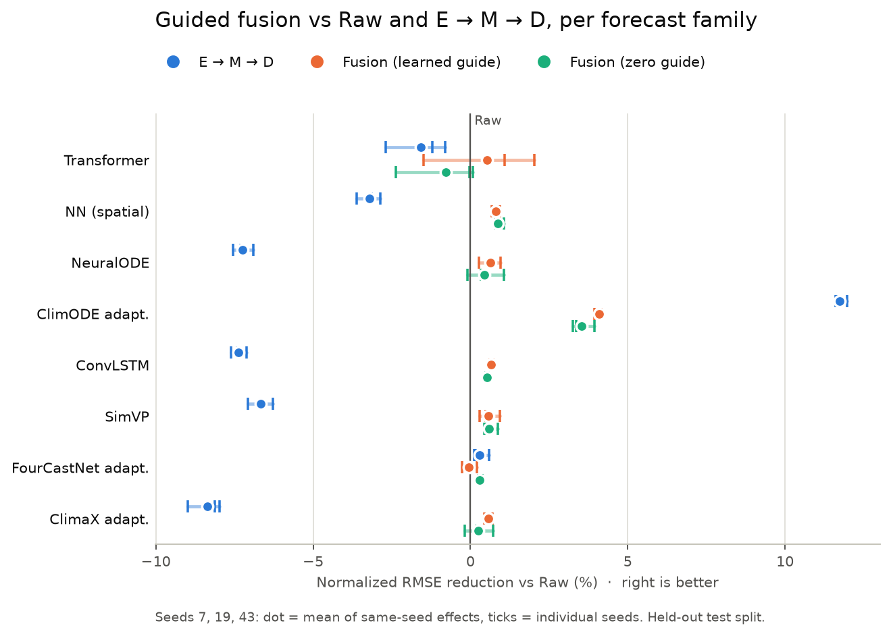
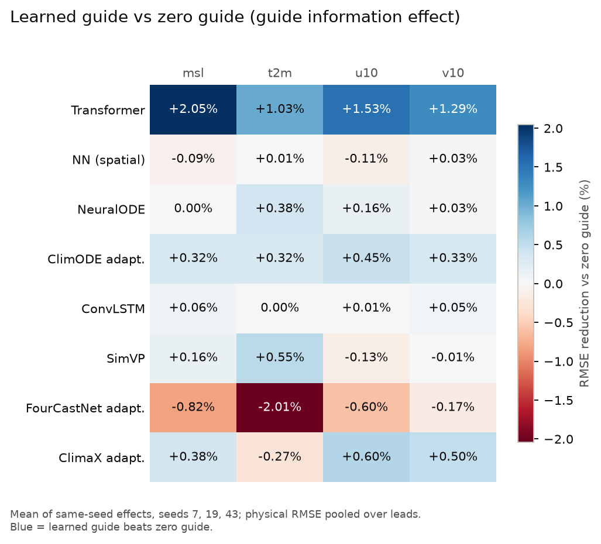

# Guided fusion 결과 (test split)

런: `runs/guided-fusion-20261002-162702` (source commit `e5d7468`), 8개 모델 × 4 arm × seed 7, 19, 43, 20 epochs.
그림 재생성:

```bash
python scripts/plot_guided_fusion_results.py --run runs/guided-fusion-20261002-162702 --output figures/guided_fusion/test
```

| arm | 경로 |
|---|---|
| raw | Raw → M → 예측장 |
| latent | E → M → D |
| guided | E → Fusion Transformer(raw, guide) → M |
| guided_zero | 같은 구조, guide = 0 (대조군) |

## Normalized RMSE (평균 ± 표본 표준편차, 낮을수록 좋음)

| model | raw | latent | guided | guided_zero |
|---|---|---|---|---|
| transformer | 0.5991 ± .0067 | 0.6084 ± .0012 | **0.5958** ± .0052 | 0.6037 ± .0017 |
| mlp | 0.5648 ± .0012 | 0.5829 ± .0009 | 0.5602 ± .0011 | **0.5599** ± .0006 |
| neural_ode | 0.5413 ± .0016 | 0.5805 ± .0004 | **0.5379** ± .0008 | 0.5389 ± .0017 |
| climode | 0.6432 ± .0006 | **0.5677** ± .0009 | 0.6169 ± .0010 | 0.6205 ± .0028 |
| convlstm | 0.5402 ± .0002 | 0.5801 ± .0014 | **0.5366** ± .0003 | 0.5373 ± .0001 |
| simvp | 0.5937 ± .0015 | 0.6333 ± .0010 | 0.5903 ± .0005 | **0.5902** ± .0002 |
| fourcastnet | 0.5897 ± .0005 | **0.5880** ± .0015 | 0.5900 ± .0012 | **0.5880** ± .0003 |
| climax | 0.5801 ± .0030 | 0.6286 ± .0059 | **0.5768** ± .0030 | 0.5787 ± .0021 |





## 해석

- fourcastnet을 제외한 7개 모델에서 guided가 raw보다 RMSE가 0.5~4% 낮다.
- 그러나 zero-guide 대조군도 대부분 비슷하게 좋아서, 이득의 상당 부분은 guide 정보보다 fusion 구조와 늘어난 파라미터에서 온다.
- guide 정보 효과(learned − zero)가 모든 변수에서 양수인 경우는 transformer(+1~2%), climode(+0.3~0.5%)뿐이다. fourcastnet은 모든 변수에서 음수다.
- E → M → D는 climode에서만 확실히 최선(raw 대비 +11.7%)이고, 나머지 모델에서는 대체로 가장 나쁘다.

## 주의

`comparison.test.json`의 `climode_benchmark.rows`에는 `guide_mode`가 없어서 learned guide와 zero guide 행을 구분할 수 없다.
그래서 변수별 수치는 run별 `*.test.json`에서 직접 읽는다.
