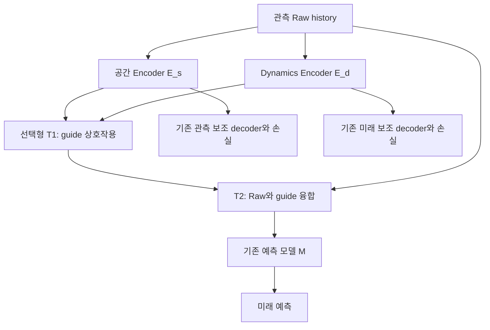

# 선택형 이중 Transformer manifold

브랜치: `feature/two-stage-guide-fusion`

공간 guide와 Dynamics guide를 **첫 Transformer `T1`에서 상호 작용**시킨 뒤,
기존 **두 번째 Fusion Transformer `T2`에서 Raw history와 결합**합니다.
예측 모델 `M`과 관측·미래 보조 decoder는 유지합니다. `T1`은 기본적으로 꺼져 있으며,
`--guide-interaction transformer`로 선택합니다. `T2`는 기존 Guided Fusion입니다.
예측 모델에 `M=transformer`를 선택하면 그것은 별도의 예측용 Transformer입니다.

\[
z_s=E_s(X,I),\quad z_d=E_d(X),\quad
(\widetilde z_s,\widetilde z_d)=T_1(z_s,z_d),
\]
\[
H=T_2(X,\widetilde z_s,\widetilde z_d),\qquad \widehat Y=M(H,I).
\]



`T1=off`는 기존 `T2(X,z_s,z_d) → M` 경로입니다. T1은 Guided+Fusion 경로에서
Dynamics Encoder가 활성화되어 있을 때만 사용할 수 있습니다. Raw와 Latent 경로는
기존 구조를 사용합니다. 위 식은 토큰 투영을 생략한 표기입니다. 실제 T1은 위치·관측 시각·
guide 유형 embedding을 포함한 두 토큰 bank에 attention을 적용하고, 원래 두 bank의
길이를 유지합니다. 전체 관측 창은 예측 원점 이하이므로 그 안에서 양방향 attention을
허용합니다. T1에 미래 label을 입력하지 않으며, 기존 `E_s`와 `E_d`는 각각
자신의 보조 경로와 예측 경로에서 가중치를 공유합니다. 예측 손실로 T1·T2와 Encoder,
예측 모델을 공동 학습합니다. 학습용 보조 손실을 T1 뒤에 다시 추가하지 않습니다.

## 켜고 끄는 두 실험의 차이

| 선택 | 실행 방법 | 의미 |
|---|---|---|
| 기존 1단 Fusion | train: `--guide-interaction off` | T1 없이 독립적으로 학습한 기준선 |
| 이중 Transformer | train: `--guide-interaction transformer --guide-interaction-depth 1` | T1을 포함해 공동 학습 |
| 학습 후 T1 우회 | evaluate: `--guide-interaction-override off` | 같은 이중 Transformer checkpoint에서 T1만 우회하는 진단 |

평가 기본값은 checkpoint의 학습 구성을 그대로 사용합니다. `off` checkpoint에
평가 때 새 T1을 추가하는 것은 지원하지 않습니다. 학습되지 않은 가중치로는 유효한
비교가 되지 않기 때문입니다. T1 우회는 분포 이동을 만들 수 있으므로, **독립 학습한
1단/2단 비교가 구조의 주실험**이고 checkpoint 우회는 의존도 진단입니다. 이중
Transformer에 의한 개선은 실험으로 확인해야 하며 추가 용량·계산량의 영향도 포함됩니다.

## 비교 matrix와 설정

기존 runner의 기본 4개 arm과 Dynamics runner의 기본 8개 arm은 그대로입니다.
새 `scripts/run_two_stage_manifold_comparison.sh`는 다음 9개를 학습합니다.

| arm | 경로/대조 |
|---|---|
| `raw` | Raw → M |
| `latent` | E_s → M → D_forecast |
| `guided` | T2(Raw, E_s) → M |
| `guided_zero` | 공간 guide를 0으로 둔 기존 Guided |
| `latent_dynamics` | (E_s + P(E_d)) → M → D_forecast |
| `guided_dynamics` | T2(Raw, E_s, E_d) → M: 1단 기준선 |
| `latent_dynamics_zero` | Latent의 dynamics 예측 입력을 0으로 둔 대조 |
| `guided_dynamics_zero` | Guided의 dynamics 예측 입력을 0으로 둔 대조 |
| `guided_dynamics_two_stage` | T2(Raw, T1(E_s,E_d)) → M |

기본 **9개 arm × 8개 M × 3개 seed = 216회 학습**, batch 16입니다.
`INCLUDE_TWO_STAGE_BYPASS=1`이면 각 이중 checkpoint의 validation/test에 T1 우회
평가를 한 번씩 추가하며, **추가 학습은 없습니다**. `INCLUDE_TWO_STAGE=0`으로
새 arm을 제외하거나 `INCLUDE_TWO_STAGE_BYPASS=0`으로 우회 진단만 제외할 수 있습니다.
두 변수를 명시적으로 지정할 때 bypass만 1로 남기는 설정은 거절합니다.
`GUIDE_INTERACTION_DEPTH`는 T1의 깊이이고, `GUIDE_FUSION_DEPTH`는 기존 T2의 깊이입니다.

공간 통계 손실과 Dynamics 통계 손실은 각각
`STATISTICAL_LOSS`, `DYNAMICS_STATISTICAL_LOSS`로 W2/KL-entropy/signed measure를
선택합니다. 기본은 `signed_measure`입니다. PINN·static penalty·flow 손실은 계속
꺼져 있고 origin 정보 입력은 유지됩니다. 세 손실을 모두 비교하려면 각각 새 RUN으로
실행하세요. 같은 RUN의 설정을 바꾸어 이어 실행하지 않습니다.

## 브랜치 받기부터 전체 학습·test·그래프까지

할당된 GPU 세션에서 실행합니다. 코드·환경·캐시·전처리·결과는 모두
`/lustre/home/yehyeon` 아래에 쓰며 ERA5 원본은 지정 위치에서 읽기만 합니다.
기본 16×32 격자, 연속 관측 6일 → 미래 1~5일입니다.

```bash
bash <<'BASH'
set -euo pipefail
cd /lustre/home/yehyeon
export DAILY_WORK
DAILY_WORK=$(mktemp -d "$PWD/climate_manifold_two_stage_XXXXXXXX")
export ERA5_ROOT=/lustre/home/mahmed/ERA5_0p25_DAILY
mkdir -p "$DAILY_WORK"/{tmp,cache,logs}
export TMPDIR="$DAILY_WORK/tmp" TMP="$DAILY_WORK/tmp" TEMP="$DAILY_WORK/tmp"
export XDG_CACHE_HOME="$DAILY_WORK/cache" PIP_CACHE_DIR="$DAILY_WORK/cache/pip"
export TORCH_HOME="$DAILY_WORK/cache/torch" HF_HOME="$DAILY_WORK/cache/huggingface"
export CUDA_CACHE_PATH="$DAILY_WORK/cache/cuda" TRITON_CACHE_DIR="$DAILY_WORK/cache/triton"
export PYTHONPYCACHEPREFIX="$DAILY_WORK/cache/pycache" MPLCONFIGDIR="$DAILY_WORK/cache/matplotlib"
export NUMBA_CACHE_DIR="$DAILY_WORK/cache/numba" PYTHONNOUSERSITE=1

git clone --single-branch --branch feature/two-stage-guide-fusion \
  https://github.com/nayehyeon61-glitch/climate_manifold.git "$DAILY_WORK/code"
cd "$DAILY_WORK/code"
python3 -m venv "$DAILY_WORK/venv"
source "$DAILY_WORK/venv/bin/activate"
python -m pip install --upgrade pip
python -m pip install 'torch==2.8.0' --index-url https://download.pytorch.org/whl/cu128
python -m pip install 'xarray==2024.11.0' -e '.[forecast,era5,test,plots]'

export PYTHON="$DAILY_WORK/venv/bin/python" DEVICE=cuda
export MODELS="mlp neural_ode climode convlstm simvp fourcastnet climax transformer"
export SEEDS="7 19 43" EPOCHS=20 BATCH_SIZE=16
export INCLUDE_DYNAMICS=1 INCLUDE_ZERO_DYNAMICS=1 DYNAMICS_ENCODER=conv_gru
export DYNAMICS_HIDDEN_DIM=32 DYNAMICS_CHANNELS=8
export INCLUDE_TWO_STAGE=1 INCLUDE_TWO_STAGE_BYPASS=1
export GUIDE_INTERACTION_DEPTH=1 GUIDE_FUSION_DEPTH=2
export STATISTICAL_LOSS=signed_measure DYNAMICS_STATISTICAL_LOSS=signed_measure
export DYNAMICS_RECONSTRUCTION_WEIGHT=0.1 DYNAMICS_STATISTICAL_WEIGHT=0.1 DYNAMICS_TENDENCY_WEIGHT=0
export INCLUDE_ZERO_GUIDE=1 INCLUDE_GUIDED_FORECAST_ONLY=0
export CONSTRAINT_DECODER=separate_surface_and_information
export VARIABLE_CONDITIONING=0 GUIDE_DIRECT_INFORMATION=1
export STATISTICAL_FLOW_WEIGHT=0 CONDITIONAL_FLOW_WEIGHT=0
export START_DATE=1979-01-01 END_DATE=2025-12-31
export TARGET_LAT_POINTS=16 TARGET_LON_POINTS=32
export HISTORY_STEPS=6 HORIZON_STEPS=5 MAX_WINDOWS=0 MAX_CASES=0 ORIGIN_STRIDE=1
export RUN_PREFLIGHT_TESTS=1 EVALUATE_TEST=1 MAKE_PLOTS=1 OMP_NUM_THREADS=4
export GPU_MAX_UTILIZATION=10 GPU_MAX_MEMORY_PERCENT=10 GPU_MIN_FREE_GIB=8 GPU_WAIT_SECONDS=0
unset ARCHIVE INFO A_CHECKPOINT RUN RESUME
printf 'Work directory: %s\n' "$DAILY_WORK"
bash scripts/run_two_stage_manifold_comparison.sh
BASH
```

GPU guard는 가시·할당 GPU의 사용률과 메모리 점유율이 각각 10% 이하이고 여유 메모리
8 GiB 이상인지 시작 시 확인하며 다른 compute process가 있는 장치는 제외합니다.
학습 중 사용률을 10%로 제한하는 기능은 아닙니다. 여유 장치가 없으면 중단합니다.
순서는 경로/GPU 확인 → CPU 연결 테스트 → 일별 전처리 → 학습·validation →
고정 checkpoint test → 비교 그래프입니다. 설정 선택 중에는 `EVALUATE_TEST=0`으로
test set을 남겨두세요. 현재 M들은 데이터와 격자에 맞춘 adaptation이며 원논문
공식 checkpoint의 성능 재현을 의미하지 않습니다.

## 결과·재개

- `comparison.json`, `comparison.test.json`: 같은 split·origin·lead의 비교.
- `*-guided_dynamics_two_stage-seed*.pt`: 이중 Transformer checkpoint.
- `*-guided_dynamics_two_stage_bypass-seed*.validation.json`, `*.test.json`:
  동일 checkpoint의 T1 우회 진단. 각 경로의 forecast NPZ도 별도 저장합니다.
- `comparison*.guide-interaction-effects.csv`: 독립 1단/2단 및 checkpoint 우회 효과.
- `plots/validation/`, `plots/test/`: 효과를 구분한 PNG/PDF 및 manifest.
- `guide_interaction_contract`: 학습한 구조. `guide_interaction_evaluation`의
  `requested`, `trained`, `effective`, `bypassed`: 이번 평가의 실제 실행 구조.

`RESUME=1 RUN="$DAILY_WORK/runs/<기존 실행 폴더>"`는 설정·소스·prepared 자료가 같고
checkpoint/report의 checksum이 일치할 때 완료된 작업을 재사용합니다. T1의 깊이,
arm 또는 bypass 설정을 변경하면 새 RUN이 필요합니다. 우회 결과를 정상 실행 결과로
바꿔 읽지 않도록 평가 계약도 검증합니다. 중단된 optimizer를 이어 학습하는 기능은
아닙니다. 학습은 끝나고 우회 평가만 누락된 경우 같은 설정으로 재개하면 해당 평가부터
생성합니다. 실험별 seed 변동성은 예측 ensemble의 불확실성이 아닙니다.

Dynamics 학습·손실·기존 비교군의 자세한 범위는
[Dynamics 문서](dual_dynamics_manifold.md)를 참고하세요.

## 구현 검증의 범위

- T1이 guide 토큰만 받는지, 시간·공간 guide 사이에 attention과 gradient가
  연결되는지, zero control에서 제거한 원본 정보가 다시 들어오지 않는지 확인합니다.
- T1 off에서 기존 state dict를 그대로 읽고 공통 모듈의 초기값을 유지합니다.
  T1 on과 같은 가중치의 bypass는 체크포인트를 수정하지 않고 비교합니다.
- 8개 예측 모델의 forward/backward, 공동 학습, 저장·복원, 미래 정답의 입력 차단을
  테스트합니다. FourCastNet·ClimaX의 실제 소규모 학습 결과도 비교 집계에 연결합니다.
- 합성 자료의 짧은 실행은 학습·validation·test·CSV·그래프 연결을 검증하는 용도입니다.
  실제 ERA5 전체 학습이나 GPU 성능 및 예측 정확도 향상을 검증한 결과가 아닙니다.
